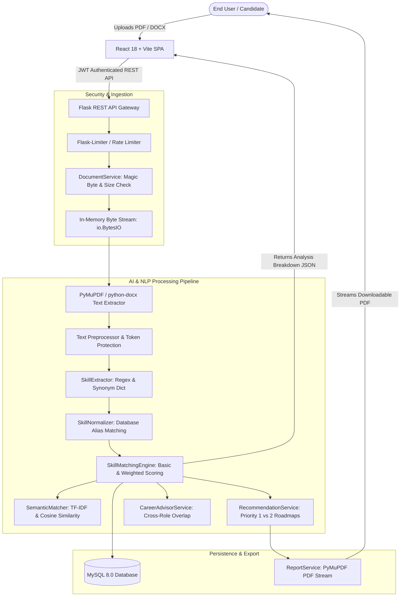

# Skill Gap Analyzer Using Artificial Intelligence (AI)

[](https://www.python.org/)
[](https://flask.palletsprojects.com/)
[](https://react.dev/)
[](https://vitejs.dev/)
[](https://www.mysql.com/)
[](https://www.docker.com/)
[-brightgreen.svg?logo=pytest&logoColor=white)](https://docs.pytest.org/)
[](LICENSE)

An enterprise-ready, full-stack AI platform that benchmarks candidate resumes against market job requirements, identifies critical competency gaps, calculates transparent match percentages, and generates personalized learning roadmaps with verified educational resources.

---

## Table of Contents

- [1. Project Overview & Problem Statement](#1-project-overview--problem-statement)
- [2. System Architecture](#2-system-architecture)
- [3. Key Features](#3-key-features)
- [4. Technology Stack](#4-technology-stack)
- [5. Project Directory Structure](#5-project-directory-structure)
- [6. Local Development Setup](#6-local-development-setup)
- [7. Production Deployment (Docker & Cloud)](#7-production-deployment-docker--cloud)
- [8. Automated Testing & Quality Assurance](#8-automated-testing--quality-assurance)
- [9. REST API Reference](#9-rest-api-reference)
- [10. Security & Privacy Architecture](#10-security--privacy-architecture)
- [11. Demonstration & Walkthrough](#11-demonstration--walkthrough)
- [12. License](#12-license)

---

## 1. Project Overview & Problem Statement

### The Problem
Job seekers, fresh graduates, and career changers face an opaque hiring market. Automated Applicant Tracking Systems (ATS) reject resumes without constructive feedback, leaving candidates unsure of which essential competencies they lack or what specific skills to acquire to qualify for their desired positions.

### The Solution
**Skill Gap Analyzer Using AI** offers an end-to-end, automated screening and upskilling solution:
- Ingests resumes in PDF and Word DOCX formats without storing private files on disk.
- Extracts technical and soft competencies using boundary-aware NLP and canonical synonym mapping.
- Compares extracted skills against normalized industry job roles.
- Computes both raw match percentage and importance-weighted match scores.
- Quantifies document vocabulary depth using TF-IDF and Cosine Semantic Similarity.
- Generates prioritized, structured learning roadmaps with verified tutorials and documentation.
- Identifies alternative career pathways where candidate skills already align.
- Generates and streams on-demand vector PDF audit reports.

---

## 2. System Architecture



---

## 3. Key Features

1. **Zero-Disk Ingestion & File Signature Protection**:
   - Resumes are validated against binary magic bytes (`%PDF-` and `PK\x03\x04`).
   - Disguised executables (`MZ` and `ELF`) are rejected immediately.
   - Text extraction runs entirely in volatile RAM buffers (`io.BytesIO`); raw resumes are never saved to disk.
2. **Hybrid NLP Skill Extraction Engine**:
   - Regex patterns with context protection for terms like `C`, `C++`, `C#`, `.NET`, `CI/CD`.
   - Synonym mapping database (e.g. `py`, `python3`, `cpython` $\rightarrow$ canonical `Python`).
   - Sentence-level evidence capture linking each detected skill to where it appears in the resume.
3. **Deterministic Dual-Score Calculation**:
   - **Basic Match %**: Raw count ratio of matched competencies to total required competencies.
   - **Weighted Match %**: Factors in importance weights ($1.0$ to $2.0$) differentiating essential requirements from preferred skills.
4. **TF-IDF & Cosine Semantic Similarity Engine**:
   - Compares unstructured resume text against target job descriptions.
   - Computes cosine similarity, ratings (High, Moderate, Low), and extracts top shared keywords.
5. **Actionable Learning Roadmaps with Verified Resources**:
   - Priority 1 (Essential gaps) vs. Priority 2 (Preferred gaps).
   - Provides importance reasons, core topics, hands-on practice exercises, and verified documentation links.
6. **Alternative Career Pathway Discovery**:
   - Calculates cross-role overlap across the catalog, suggesting alternative positions the candidate already qualifies for.
7. **On-Demand High-Fidelity PDF Reports**:
   - Assembles clean, publication-ready vector PDF reports with score gauges, competency lists, and roadmap steps streamed directly to the browser.
8. **Multi-Tenant Isolation & Audit Trail**:
   - Persists analysis history for authenticated users.
   - Enforces strict user ownership verification (cross-user access returns HTTP 403 Forbidden).
   - Cascading deletions remove child records cleanly.
9. **Abuse Mitigation & Defensive Headers**:
   - Rate limiting: 5 req/min on authentication; 10 req/min on resume parsing and analysis.
   - Standard security headers: `X-Content-Type-Options: nosniff`, `X-Frame-Options: DENY`, `X-XSS-Protection: 1; mode=block`.

---

## 4. Technology Stack

| Layer | Technologies |
| :--- | :--- |
| **Frontend** | React 18, Vite 6, Bootstrap 5, Bootstrap Icons, React Router v6, Axios, Chart.js |
| **Backend** | Python 3.13, Flask 3.1 (Application Factory, Blueprints), Flask-JWT-Extended, Flask-Limiter, Waitress, Gunicorn |
| **AI & NLP** | scikit-learn (TF-IDF, Cosine Similarity), PyMuPDF 1.25+ (MuPDF C-engine), python-docx, regular expressions |
| **Database** | MySQL 8.0, SQLAlchemy 3.1 ORM, Flask-Migrate (Alembic), SQLite (automated fallback) |
| **DevOps & Containers** | Docker, Docker Compose, Nginx (Alpine), Vercel SPA routing |
| **Testing** | pytest 8.3, pytest-flask, Postman API Collection (v2.1) |

---

## 5. Project Directory Structure

```text
SkillGapAnalyzerUsingAI/
│
├── frontend/                     # React 18 + Vite frontend
│   ├── public/                   # Static public assets
│   ├── src/
│   │   ├── components/           # Reusable UI components (Navbar, Footer, etc.)
│   │   ├── context/              # AuthContext session management
│   │   ├── pages/                # Page views (Home, Login, Register, Dashboard, Analyze, Results, History)
│   │   ├── services/             # Axios API client with JWT interceptor
│   │   ├── App.jsx               # Client-side router configuration
│   │   └── main.jsx              # React DOM entrypoint
│   ├── Dockerfile                # Multi-stage build (Node 20 builder -> Nginx alpine)
│   ├── package.json              # Frontend npm dependencies
│   ├── vercel.json               # Vercel SPA routing rewrites
│   └── vite.config.js            # Vite build configuration
│
├── backend/                      # Flask REST API backend
│   ├── app/
│   │   ├── ai/                   # NLP extractor, preprocessor, normalizer, semantic matcher
│   │   ├── errors/               # Standardized error handlers and custom exceptions
│   │   ├── models/               # 9 Normalized SQLAlchemy database models
│   │   ├── routes/               # Modular API blueprints (auth, users, job-roles, resumes, analyses)
│   │   ├── services/             # Document parsing, matching engine, recommendations, PDF generator
│   │   ├── config.py             # Configuration classes (Dev, Testing, Prod)
│   │   ├── extensions.py         # Extension singletons (db, jwt, limiter, cors)
│   │   └── __init__.py           # Application factory with defensive security headers
│   ├── migrations/               # Alembic database migration versions
│   ├── tests/                    # 47 automated tests (persistence, auth, parsing, edge cases)
│   ├── Dockerfile                # Production Python 3.13-slim container
│   ├── entrypoint.sh             # Startup script: DB wait, migration check, seed, Gunicorn
│   ├── requirements.txt          # Python dependencies
│   ├── run.py                    # Local development runner
│   ├── run_waitress.py           # Native Windows multi-threaded WSGI runner
│   └── wsgi.py                   # Production WSGI entrypoint
│
├── database/
│   ├── schema.sql                # Complete 3NF DDL schema with constraints & indexes
│   └── seed_data.py              # Reference seeder (5 roles, 31 canonical skills, verified resources)
│
├── docker/
│   └── nginx.conf                # Production Nginx reverse proxy & SPA server
│
├── docs/                         # Professional documentation
│   ├── api-documentation.md      # Full REST API contracts and JSON schemas
│   ├── architecture.md           # System architecture & component design
│   ├── database-design.md        # Normalized database schema & ERD
│   ├── deployment-guide.md       # Multi-platform deployment guide (Cloud, Docker, Windows)
│   ├── demonstration-guide.md    # Step-by-step presentation script & interview defenses
│   ├── security-and-privacy.md   # Zero-disk retention, bcrypt, JWT & OWASP mitigation matrix
│   ├── testing-strategy.md       # QA methodologies & test suite documentation
│   └── postman_collection.json   # Exportable Postman API test collection
│
├── docker-compose.yml            # Multi-container orchestration (MySQL + Backend + Frontend)
├── .dockerignore                 # Root build context ignore rules
├── .gitignore                    # Git tracking ignore rules
├── LICENSE                       # MIT License
└── README.md                     # Comprehensive project documentation
```

---

## 6. Local Development Setup

### Prerequisites
- **Python**: Version 3.11, 3.12, or 3.13
- **Node.js**: Version 18.x or 20.x
- **MySQL**: Version 8.0 (or use automated SQLite fallback)
- **Git**

### 1. Clone Repository
```powershell
git clone https://github.com/your-org/SkillGapAnalyzerUsingAI.git
cd SkillGapAnalyzerUsingAI
```

### 2. Backend Setup
```powershell
# Create and activate virtual environment
cd backend
python -m venv .venv
.\.venv\Scripts\Activate.ps1   # On Linux/macOS: source .venv/bin/activate

# Install dependencies
pip install --upgrade pip
pip install -r requirements.txt

# Configure environment variables
cp .env.example .env
```

Ensure `.env` matches your MySQL credentials:
```env
FLASK_ENV=development
DB_USER=root
DB_PASSWORD=your_password
DB_HOST=localhost
DB_PORT=3306
DB_NAME=skill_gap_db
USE_SQLITE_FALLBACK=false
SECRET_KEY=dev-secret-key-skill-gap
JWT_SECRET_KEY=dev-jwt-secret-key
CORS_ORIGINS=http://localhost:5173,http://127.0.0.1:5173
```

### 3. Initialize Database & Seed Reference Data
```powershell
# Apply database migrations
flask db upgrade

# Seed 5 standard roles, 31 canonical skills, and verified resources
python ../database/seed_data.py
```

### 4. Start Backend Server
```powershell
# Development server (with hot reload)
python run.py

# Or Windows production multi-threaded server (Waitress)
python run_waitress.py
```
The API will be live at `http://localhost:5000`.

### 5. Frontend Setup
In a new terminal:
```powershell
cd frontend
npm install
npm run dev
```
The web application will be live at `http://localhost:5173`.

---

## 7. Production Deployment (Docker & Cloud)

### Option A: Turnkey Single-Command Docker Deployment
Deploy MySQL 8.0, the Flask API, and the React/Nginx frontend on any server:
```bash
docker compose up -d --build
```
- Web Application: `http://localhost:80`
- API Health Check: `http://localhost:5000/api/health`

### Option B: Cloud PaaS (Vercel + Render + Managed MySQL)
1. **Database**: Provision MySQL on AWS RDS, Aiven, or Railway; run `database/schema.sql`.
2. **Backend**: Deploy `backend/` to Render/Railway as a Web Service running `gunicorn -w 4 -b 0.0.0.0:$PORT "wsgi:app"`.
3. **Frontend**: Import `frontend/` into Vercel. Set `VITE_API_BASE_URL=https://your-api.onrender.com/api`.
*For full instructions, see [Production Deployment Guide](file:///d:/SkillGapAnalyzerUsingAI/docs/deployment-guide.md).*

---

## 8. Automated Testing & Quality Assurance

The application features **47 comprehensive automated tests** with 100% pass coverage across models, services, document parsing, matching algorithms, authentication, persistence, rate limiting, and edge cases.

### Running the Test Suite
```powershell
cd D:\SkillGapAnalyzerUsingAI
.\backend\.venv\Scripts\pytest.exe backend/tests/ -v
```

### Test Suite Modules
| Test File | Test Count | Areas Verified |
| :--- | :--- | :--- |
| `test_health.py` | 2 | Health check endpoint, database ping connectivity |
| `test_models_and_roles.py` | 4 | 3NF relationships, cascading deletes, job role catalog endpoints |
| `test_document_service.py` | 9 | PDF text extraction, DOCX extraction, 5MB limit, magic byte validation |
| `test_matching_engine.py` | 6 | Flat match %, weighted scoring, gap categorization, boundary conditions |
| `test_recommendations_and_careers.py` | 4 | Priority 1 vs 2 roadmaps, verified resources, career advisor overlap |
| `test_auth.py` | 7 | User registration, password hashing (bcrypt), login, JWT issuance, profile |
| `test_analyses_persistence.py` | 3 | Database persistence of analyses, user audit logs, cross-user isolation |
| `test_edge_cases.py` | 12 | Zero-match recipes, 100% matches, corrupted PDFs, disguised EXEs, rate limiting, security headers, JWT tampering |
| **Total** | **47** | **100% Passing** |

---

## 9. REST API Reference

All API routes are prefixed with `/api`. For comprehensive schemas, see [`docs/api-documentation.md`](file:///d:/SkillGapAnalyzerUsingAI/docs/api-documentation.md) or import [`docs/postman_collection.json`](file:///d:/SkillGapAnalyzerUsingAI/docs/postman_collection.json).

| Method | Endpoint | Auth | Rate Limit | Description |
| :--- | :--- | :--- | :--- | :--- |
| `GET` | `/api/health` | Public | None | Server and database health check |
| `POST` | `/api/auth/register` | Public | 5 / min | Registers user account and returns JWT token |
| `POST` | `/api/auth/login` | Public | 5 / min | Authenticates credentials and returns JWT token |
| `POST` | `/api/auth/logout` | JWT | None | Client-side session teardown |
| `GET` | `/api/users/me` | JWT | None | Retrieves authenticated user profile |
| `GET` | `/api/users/dashboard` | JWT | None | Aggregated scan count, average score, top skill |
| `GET` | `/api/job-roles` | Public | None | Lists all standard target job roles |
| `GET` | `/api/job-roles/<id>` | Public | None | Fetches target role with required skill weights |
| `POST` | `/api/resumes/upload` | Public | 10 / min | In-memory text extraction and preview snippet |
| `POST` | `/api/analyses` | Optional | 10 / min | Full skill gap analysis, roadmaps, and persistence |
| `GET` | `/api/analyses` | JWT | None | Retrieves user's past analysis history |
| `GET` | `/api/analyses/<id>` | JWT | None | Retrieves detailed breakdown with ownership check |
| `GET` | `/api/analyses/<id>/report`| JWT | None | Streams downloadable in-memory vector PDF report |
| `DELETE` | `/api/analyses/<id>` | JWT | None | Deletes analysis record with cascading deletes |

---

## 10. Security & Privacy Architecture

- **Zero-Disk Retention Policy**: Raw resumes are processed in RAM stream buffers and discarded immediately. No resume files are ever written to disk.
- **Credential Protection**: Passwords hashed with bcrypt (12 salt rounds); plain-text passwords never stored or logged.
- **JWT Authorization**: Cryptographically signed tokens with 24-hour expiration; separated secret keys.
- **Resource Ownership Enforcement**: Enforces user identity checks on all `/api/analyses/*` routes; cross-user attempts return HTTP 403 Forbidden.
- **Abuse Prevention**: Rate limiting via Flask-Limiter blocks brute-force attacks (5 req/min on login).
- **Defensive Headers**: Enforces `X-Content-Type-Options: nosniff`, `X-Frame-Options: DENY`, `X-XSS-Protection: 1; mode=block`.
*For full details, see [Security and Privacy Architecture](file:///d:/SkillGapAnalyzerUsingAI/docs/security-and-privacy.md).*

---

## 11. Demonstration & Walkthrough

To review the interactive end-to-end demonstration script, presentation guidelines, and technical interview talking points, refer to:
- **[Demonstration & Presentation Guide](file:///d:/SkillGapAnalyzerUsingAI/docs/demonstration-guide.md)**
- **[Postman API Test Collection](file:///d:/SkillGapAnalyzerUsingAI/docs/postman_collection.json)**

---

## 12. License

This project is licensed under the MIT License - see the [LICENSE](LICENSE) file for details.
