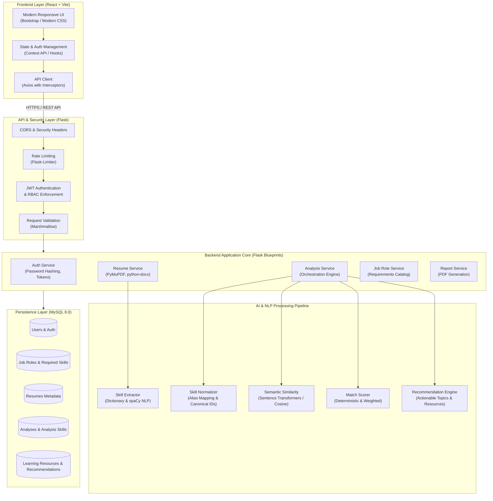
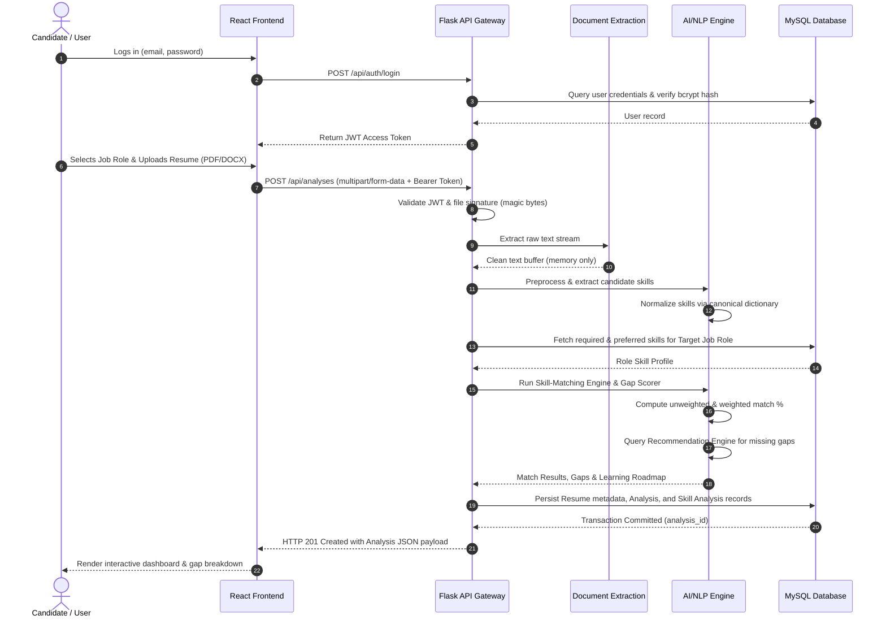
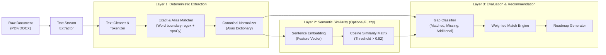

# System Architecture: Skill Gap Analyzer Using Artificial Intelligence (AI)

## 1. High-Level System Overview

The **Skill Gap Analyzer Using AI** is a production-oriented, full-stack web application designed to bridge the gap between job seekers' current qualifications and market job requirements. 

The application enables candidates to upload resumes (PDF/DOCX), parses and normalizes technical and soft skills, compares candidate competencies against target job roles or custom job descriptions, computes transparent match metrics, identifies critical missing skills, and generates personalized, actionable learning roadmaps.

---

## 2. The 17 Logical Components

The system is partitioned into seventeen distinct, decoupled architectural components:

1. **React Frontend**: Single Page Application (SPA) built with React 18 and Vite, offering responsive design, accessible forms, charts, and analysis workflows.
2. **Flask REST API Backend**: Python application factory serving strictly versioned, stateless RESTful endpoints (`/api/v1/...`).
3. **Authentication Module**: Secure JWT-based authentication featuring token signing, bcrypt password hashing, and user identity injection.
4. **Resume Upload and Validation Module**: MIME-type inspector, magic-byte checker, and size-limiting firewall protecting backend storage from malicious files.
5. **Document Text Extraction Module**: High-fidelity text extractors using `PyMuPDF` for PDF streams and `python-docx` for XML-based Word documents.
6. **Resume Preprocessing Module**: Text normalization pipeline handling whitespaces, hyphenations, special characters, and token boundaries without stripping crucial acronyms (e.g., C++, C#, .NET).
7. **Skill Extraction Module**: Hybrid extractor combining curated canonical dictionaries, regex boundaries, and spaCy PhraseMatcher / EntityRuler.
8. **Skill Normalization Module**: Alias-to-canonical graph resolver that unifies synonyms (e.g., `React`, `ReactJS`, `React.js` $\rightarrow$ `React.js`).
9. **Job-Role and Job-Requirement Module**: Catalog and repository layer managing standardized industry roles, essential skills, and preferred skills.
10. **Skill-Matching Engine**: Transparent comparison engine separating matched skills, missing skills, and extraneous candidate skills.
11. **AI-Based Similarity Module**: Semantic similarity evaluator utilizing sentence embeddings and cosine similarity to map non-exact or descriptive qualifications.
12. **Skill-Gap Calculation Module**: Mathematical scoring engine producing both unweighted and weighted match percentages with algorithm version tracking.
13. **Recommendation Engine**: Curated knowledge base mapping identified missing skills to concrete study topics, practice projects, and verified documentation links.
14. **Career-Role Recommendation Module**: Alternate career discovery engine suggesting related industry roles based on extracted skill overlap.
15. **Report-Generation Module**: Report compiler creating structured dashboard views and downloadable PDF analysis summaries.
16. **MySQL Database**: ACID-compliant relational persistence layer with normalized schemas, foreign-key integrity, and indexed query paths.
17. **Automated Testing Module**: End-to-end test suites covering unit logic, integration endpoints, security boundaries, and extraction accuracy.

---

## 3. End-to-End Data Flow

The lifecycle of an analysis follows a linear, deterministic pipeline:

---

## 4. AI & NLP Pipeline Architecture

To guarantee accuracy and avoid LLM hallucinations or unpredictable parsing, skill extraction and matching is built with a multi-tiered architecture:

### Deterministic vs. Semantic Balance
1. **Deterministic Matching (Primary)**: Guarantees high precision ($>95\%$). Word boundaries `\b` prevent substring collisions (e.g., matching the programming language `C` will not trigger inside `CSS`, `Cloud`, or `Basic`).
2. **Semantic Similarity (Secondary)**: Used to highlight descriptive resume bullets (e.g., "orchestrated container deployments" $\rightarrow$ `Docker / Kubernetes`) with confidence score annotations rather than blindly assuming equivalence.

---

## 5. Security & Privacy Model

Resumes contain Personally Identifiable Information (PII). The application enforces strict data governance:

1. **Zero Raw Resume Disk Retention**: Uploaded documents are read directly from memory streams or immediate temporary buffers that are destroyed upon processing completion.
2. **Strict User Isolation**: All database queries for analyses, resumes, and recommendations filter by `user_id` extracted from the cryptographically verified JWT (`flask_jwt_extended`). A user cannot access or enumerate another user's records.
3. **MIME & Magic Byte Validation**: Filename extensions are never trusted. File headers are checked against standard byte signatures (`%PDF-` for PDFs, `PK\x03\x04` for DOCX).
4. **OWASP Compliance**: Parameterized queries via SQLAlchemy ORM (SQL Injection immunity), password hashing using `bcrypt` (12 work factor rounds), and explicit CORS whitelists.

