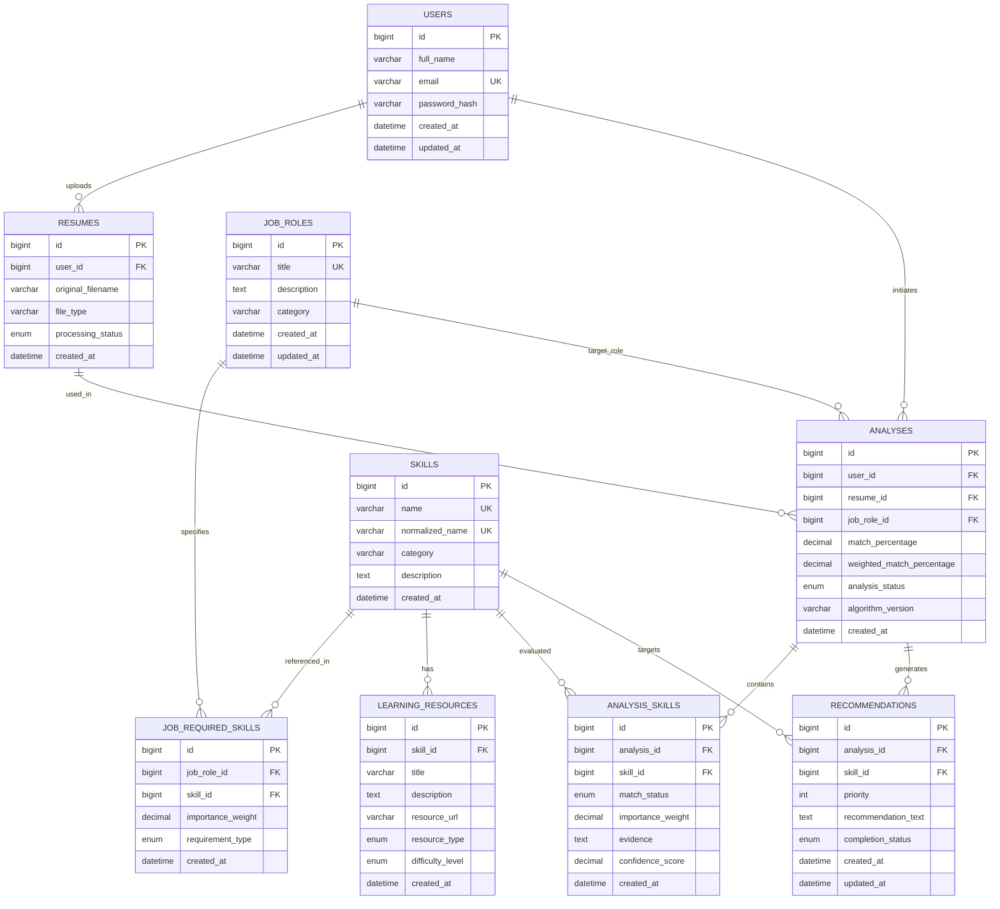

# Database Design Specification: Skill Gap Analyzer Using AI

## 1. Relational Database Overview

The system uses **MySQL 8.0** as its primary persistence engine, managed via **SQLAlchemy ORM** and **Flask-Migrate** (Alembic). The schema is strictly normalized up to Third Normal Form (3NF) to prevent redundant data, ensure referential integrity, and allow fast analytical querying.

---

## 2. Entity-Relationship Diagram (ERD)

---

## 3. Detailed Table Specifications

### 3.1. `users`
Stores credentials and basic identity for registered users.
- **Primary Key**: `id` (BIGINT, AUTO_INCREMENT)
- **Columns**:
  - `full_name`: VARCHAR(120), NOT NULL
  - `email`: VARCHAR(255), UNIQUE, NOT NULL (Indexed for fast lookup)
  - `password_hash`: VARCHAR(255), NOT NULL (bcrypt hash string)
  - `created_at`: DATETIME, DEFAULT CURRENT_TIMESTAMP
  - `updated_at`: DATETIME, DEFAULT CURRENT_TIMESTAMP ON UPDATE CURRENT_TIMESTAMP

### 3.2. `job_roles`
Standardized industry job profiles against which candidate resumes are evaluated.
- **Primary Key**: `id` (BIGINT, AUTO_INCREMENT)
- **Columns**:
  - `title`: VARCHAR(150), UNIQUE, NOT NULL
  - `description`: TEXT, NULL
  - `category`: VARCHAR(100), NOT NULL (e.g., 'Frontend', 'Backend', 'Data Science', 'DevOps')
  - `created_at`: DATETIME, DEFAULT CURRENT_TIMESTAMP
  - `updated_at`: DATETIME, DEFAULT CURRENT_TIMESTAMP ON UPDATE CURRENT_TIMESTAMP

### 3.3. `skills`
Master catalog of canonical skills, technical domains, and tools.
- **Primary Key**: `id` (BIGINT, AUTO_INCREMENT)
- **Columns**:
  - `name`: VARCHAR(100), UNIQUE, NOT NULL (Canonical name: e.g., 'React.js')
  - `normalized_name`: VARCHAR(100), UNIQUE, NOT NULL (Normalized lowercase slug: e.g., 'react.js')
  - `category`: VARCHAR(80), NOT NULL (e.g., 'Programming Language', 'Framework', 'Database', 'Cloud', 'Soft Skill')
  - `description`: TEXT, NULL
  - `created_at`: DATETIME, DEFAULT CURRENT_TIMESTAMP

### 3.4. `job_required_skills`
Associative table linking job roles to their expected skills with weightings.
- **Primary Key**: `id` (BIGINT, AUTO_INCREMENT)
- **Columns**:
  - `job_role_id`: BIGINT, NOT NULL, FOREIGN KEY (`job_roles.id`) ON DELETE CASCADE
  - `skill_id`: BIGINT, NOT NULL, FOREIGN KEY (`skills.id`) ON DELETE CASCADE
  - `importance_weight`: DECIMAL(3, 2), DEFAULT 1.00 (Scale 0.10 to 5.00)
  - `requirement_type`: ENUM('essential', 'preferred'), DEFAULT 'essential'
  - `created_at`: DATETIME, DEFAULT CURRENT_TIMESTAMP
- **Constraints**:
  - UNIQUE KEY `uq_job_role_skill` (`job_role_id`, `skill_id`)

### 3.5. `resumes`
Tracks uploaded resume metadata and audit logs. Raw file binaries are parsed in memory and not retained.
- **Primary Key**: `id` (BIGINT, AUTO_INCREMENT)
- **Columns**:
  - `user_id`: BIGINT, NOT NULL, FOREIGN KEY (`users.id`) ON DELETE CASCADE
  - `original_filename`: VARCHAR(255), NOT NULL
  - `file_type`: VARCHAR(20), NOT NULL ('pdf', 'docx')
  - `processing_status`: ENUM('pending', 'completed', 'failed'), DEFAULT 'completed'
  - `created_at`: DATETIME, DEFAULT CURRENT_TIMESTAMP
- **Indexes**:
  - INDEX `idx_resume_user` (`user_id`)

### 3.6. `analyses`
Historical records of skill-gap analysis sessions executed by users.
- **Primary Key**: `id` (BIGINT, AUTO_INCREMENT)
- **Columns**:
  - `user_id`: BIGINT, NOT NULL, FOREIGN KEY (`users.id`) ON DELETE CASCADE
  - `resume_id`: BIGINT, NULL, FOREIGN KEY (`resumes.id`) ON DELETE SET NULL
  - `job_role_id`: BIGINT, NOT NULL, FOREIGN KEY (`job_roles.id`) ON DELETE RESTRICT
  - `match_percentage`: DECIMAL(5, 2), NOT NULL (0.00 to 100.00)
  - `weighted_match_percentage`: DECIMAL(5, 2), NOT NULL (0.00 to 100.00)
  - `analysis_status`: ENUM('completed', 'failed', 'archived'), DEFAULT 'completed'
  - `algorithm_version`: VARCHAR(20), DEFAULT 'v1.0'
  - `created_at`: DATETIME, DEFAULT CURRENT_TIMESTAMP
- **Indexes**:
  - INDEX `idx_analyses_user` (`user_id`, `created_at` DESC)

### 3.7. `analysis_skills`
Detailed breakdown of each skill evaluated in a given analysis session.
- **Primary Key**: `id` (BIGINT, AUTO_INCREMENT)
- **Columns**:
  - `analysis_id`: BIGINT, NOT NULL, FOREIGN KEY (`analyses.id`) ON DELETE CASCADE
  - `skill_id`: BIGINT, NOT NULL, FOREIGN KEY (`skills.id`) ON DELETE RESTRICT
  - `match_status`: ENUM('matched', 'missing', 'additional'), NOT NULL
  - `importance_weight`: DECIMAL(3, 2), DEFAULT 1.00
  - `evidence`: TEXT, NULL (Snippet or sentence where the skill was found in resume)
  - `confidence_score`: DECIMAL(4, 3), DEFAULT 1.000 (Confidence 0.000 to 1.000)
  - `created_at`: DATETIME, DEFAULT CURRENT_TIMESTAMP
- **Indexes**:
  - INDEX `idx_analysis_skill` (`analysis_id`, `match_status`)

### 3.8. `learning_resources`
Knowledge base of curated, verified tutorials, official documentation, and courses.
- **Primary Key**: `id` (BIGINT, AUTO_INCREMENT)
- **Columns**:
  - `skill_id`: BIGINT, NOT NULL, FOREIGN KEY (`skills.id`) ON DELETE CASCADE
  - `title`: VARCHAR(255), NOT NULL
  - `description`: TEXT, NULL
  - `resource_url`: VARCHAR(500), NOT NULL
  - `resource_type`: ENUM('documentation', 'course', 'tutorial', 'book', 'project'), NOT NULL
  - `difficulty_level`: ENUM('beginner', 'intermediate', 'advanced'), DEFAULT 'beginner'
  - `created_at`: DATETIME, DEFAULT CURRENT_TIMESTAMP
- **Indexes**:
  - INDEX `idx_res_skill` (`skill_id`)

### 3.9. `recommendations`
Personalized roadmap items generated for a candidate's missing skills.
- **Primary Key**: `id` (BIGINT, AUTO_INCREMENT)
- **Columns**:
  - `analysis_id`: BIGINT, NOT NULL, FOREIGN KEY (`analyses.id`) ON DELETE CASCADE
  - `skill_id`: BIGINT, NOT NULL, FOREIGN KEY (`skills.id`) ON DELETE RESTRICT
  - `priority`: INT, DEFAULT 1 (1 = High/Essential, 2 = Medium/Preferred)
  - `recommendation_text`: TEXT, NOT NULL (Concrete learning steps)
  - `completion_status`: ENUM('pending', 'in_progress', 'completed'), DEFAULT 'pending'
  - `created_at`: DATETIME, DEFAULT CURRENT_TIMESTAMP
  - `updated_at`: DATETIME, DEFAULT CURRENT_TIMESTAMP ON UPDATE CURRENT_TIMESTAMP

